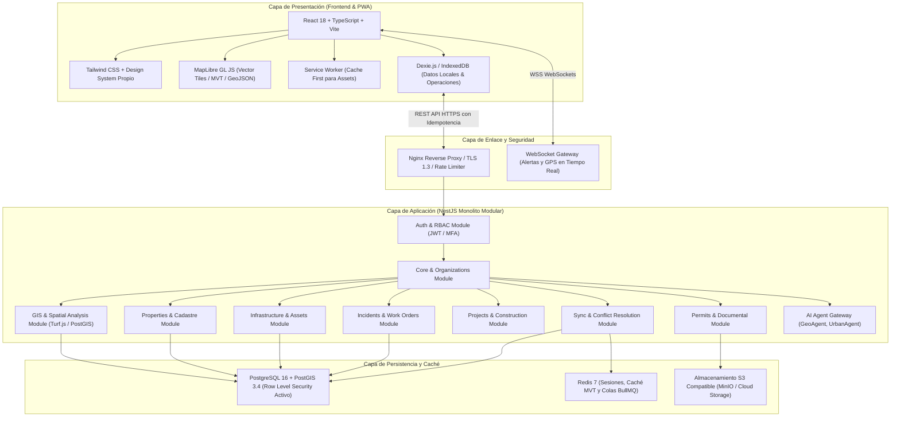

# TERRANOVA — Arquitectura del Sistema (ARCHITECTURE.md)
**Código del Documento:** F1-03  
**Versión:** 1.0.0  
**Fecha:** 2026-11-05  
**Estado:** Aprobado  

---

## 1. Visión y Principios Arquitectónicos
TERRANOVA está estructurada como un **Monolito Modular de Alto Rendimiento** en el backend y una **Progressive Web App (PWA) Offline-First** en el frontend, diseñada para operar en un modelo híbrido:
1. **Cloud Multi-tenant:** Instancia central administrada con aislamiento lógico y RLS en PostgreSQL para clientes SaaS.
2. **Cloud Dedicado:** Instancia y base de datos dedicadas en infraestructura de nube administrada.
3. **Private On-premise:** Despliegue en centros de datos del cliente o redes desconectadas (*Air-gapped*) con validación offline de licencias criptográficas.

---

## 2. Diagrama de Arquitectura de Capas



---

## 3. Descomposición de Módulos de Backend (NestJS)

El backend se organiza en módulos de dominio desacoplados pero empaquetados en un solo runtime para optimizar uso de memoria y facilitar el despliegue On-premise:
```
apps/api/src/
├── common/             # Interceptores, Pipes de validación, Filtros de excepción globales
├── auth/               # Estrategias JWT, Guardias RBAC, TOTP MFA, Sesiones
├── organizations/      # Tenant context middleware, departamentos, configuración
├── territories/        # Estructura INEGI (Estados, Municipios, Colonias, AGEBs)
├── gis/                # Capas, Teselas MVT dinámicas, Buffer, Intersecciones
├── properties/         # Predios, claves catastrales, cédulas de predio
├── infrastructure/     # Activos urbanos, bitácoras de mantenimiento
├── incidents/          # Mesa de control de reportes, máquina de estados, evidencias
├── citizen/            # Portal ciudadano, verificación de captcha, consulta de folios
├── projects/           # Obras públicas, estimaciones, avance físico y financiero
├── permits/            # Licencias de construcción, expedientes, revisiones
├── analytics/          # Agregaciones espaciales, mapas de calor, reportes PDF
├── sync/               # Protocolo de enlace offline, deduplicación, resolución de conflictos
└── ai/                 # Puerta de enlace agéntica (GeoAgent, InfraAgent, UrbanAgent)
```

---

## 4. Estrategia de Aislamiento Multi-Tenant (PostgreSQL RLS)

Cada llamada autenticada a la API REST o WebSocket pasa por un Middleware de Organización que valida el token JWT del usuario y abre una transacción de base de datos estableciendo la variable de sesión:
```typescript
// tenant-context.middleware.ts
await entityManager.query(`SET LOCAL app.current_organization_id = '${user.organizationId}';`);
```

En la base de datos, cada tabla contiene la política de seguridad RLS:
```sql
ALTER TABLE properties ENABLE ROW LEVEL SECURITY;
CREATE POLICY tenant_isolation_policy ON properties
    FOR ALL
    USING (organization_id = current_setting('app.current_organization_id', true)::uuid);
```
Si un programador olvida agregar `WHERE organization_id = ...`, el motor de PostgreSQL descarta físicamente cualquier registro ajeno a nivel de bloque de disco, haciendo imposible la fuga de datos cross-tenant.

---

## 5. Estrategia de Despliegue Híbrido (Single Codebase)

La distinción entre Cloud y Private se gobierna por la variable de entorno `DEPLOYMENT_MODE`:
- `DEPLOYMENT_MODE=CLOUD_SAAS`: Habilita registro de organizaciones por suscripción, cobros automatizados y multi-tenancy dinámico.
- `DEPLOYMENT_MODE=PRIVATE_ONPREMISE`: Se bloquea la creación de organizaciones externas, se fija la organización institucional del cliente, se activa el motor de validación de licencias RSA-4096 offline y se redirigen los servicios de almacenamiento a un bucket MinIO local o NFS institucional.

---

## 6. Monitoreo y Observabilidad
- **Métricas y Trazas:** Instrumentación nativa con **OpenTelemetry (OTel)** exportable a Prometheus/Grafana o Datadog.
- **Logs Estructurados:** Formato JSON con correlación `trace_id`, `organization_id` y `user_id`.
