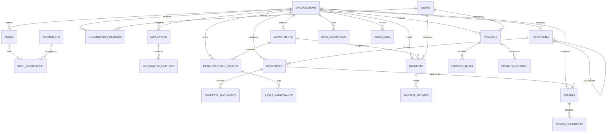

# TERRANOVA — Modelo de Datos y Diseño Espacial PostGIS (DATABASE_DESIGN.md)
**Código del Documento:** F1-04  
**Versión:** 1.0.0  
**Fecha:** 2026-11-05  
**Motor:** PostgreSQL 16 + PostGIS 3.4  

---

## 1. Principios de Persistencia y Estándar Espacial
- **Identificadores Únicos:** `UUID v4` generado automáticamente (`gen_random_uuid()`).
- **Sistema de Referencia:** Coordenadas almacenadas en **WGS 84 (`EPSG:4326`)** para interoperabilidad GeoJSON/Vector Tiles. Cálculos métricos de longitud y superficie transformados en tiempo de ejecución a **ITRF2008 (`EPSG:6362`)** o zonas UTM locales mediante `ST_Transform`.
- **Indexación Espacial:** Índices `GIST` en todas las columnas geométricas para optimizar intersecciones (`ST_Intersects`), contenciones (`ST_Contains`) y proximidad (`ST_DWithin`).
- **Aislamiento Multi-Tenant:** Columna `organization_id UUID NOT NULL` presente en todas las tablas con políticas activas de Row Level Security (RLS).
- **Borrado Lógico:** Columna `deleted_at TIMESTAMPTZ NULL` en entidades de valor legal y financiero.

---

## 2. Diagrama Entidad-Relación (ERD)

---

## 3. Diccionario de Datos Esencial

### 3.1 `organizations`
| Campo | Tipo | Nulo | Descripción |
|---|---|---|---|
| `id` | UUID | NO | Llave primaria |
| `code` | VARCHAR(50) | NO | Código único (Ej. `MUN-CDMX-015`) |
| `legal_name` | VARCHAR(255) | NO | Razón social o nombre oficial |
| `trade_name` | VARCHAR(255) | NO | Nombre comercial institucional |
| `tenant_type` | VARCHAR(50) | NO | `MUNICIPALITY`, `STATE_GOV`, `DEVELOPER`, `CONSTRUCTION`, `UTILITIES` |
| `cve_ent` | VARCHAR(2) | SÍ | Clave INEGI de Entidad Federativa (01-32) |
| `cve_mun` | VARCHAR(3) | SÍ | Clave INEGI de Municipio (001-2477) |
| `settings` | JSONB | NO | Configuración de marca, límites, logos y CRS preferido |
| `is_active` | BOOLEAN | NO | Estado de operación del tenant |

### 3.2 `territories` (INEGI MGN)
| Campo | Tipo | Nulo | Descripción |
|---|---|---|---|
| `id` | UUID | NO | Llave primaria |
| `organization_id`| UUID | NO | Tenant propietario |
| `parent_id` | UUID | SÍ | Territorio superior jerárquico |
| `name` | VARCHAR(150) | NO | Nombre del territorio (Ej. "San Pedro Garza García") |
| `territory_type`| VARCHAR(50) | NO | `STATE`, `MUNICIPALITY`, `LOCALITY`, `SECTOR`, `COLONIA`, `AGEB` |
| `cve_geo` | VARCHAR(20) | SÍ | Clave geográfica unificada de INEGI |
| `geom` | GEOMETRY(MultiPolygon, 4326) | NO | Polígono oficial georreferenciado (Índice GIST) |

### 3.3 `properties` (Catastro)
| Campo | Tipo | Nulo | Descripción |
|---|---|---|---|
| `id` | UUID | NO | Llave primaria |
| `organization_id`| UUID | NO | Tenant propietario |
| `territory_id` | UUID | SÍ | Colonia o AGEB de pertenencia |
| `cadastral_key` | VARCHAR(50) | NO | Clave catastral estandarizada |
| `property_type` | VARCHAR(50) | NO | `URBANO`, `SUBURBANO`, `RUSTICO`, `INDUSTRIAL` |
| `land_use` | VARCHAR(50) | NO | `HABITACIONAL`, `COMERCIAL`, `MIXTO`, `EQUIPAMIENTO` |
| `land_area_sqm` | NUMERIC(12,2)| NO | Superficie de terreno en metros cuadrados |
| `built_area_sqm`| NUMERIC(12,2)| NO | Superficie construida en metros cuadrados |
| `cadastral_value`| NUMERIC(15,2)| SÍ | Valor catastral fiscal estimado |
| `geom` | GEOMETRY(Polygon, 4326) | NO | Polígono perimetral del lote (Índice GIST) |
| `owner_info` | JSONB | SÍ | Datos confidenciales de propietarios (Acceso restringido) |

### 3.4 `incidents`
| Campo | Tipo | Nulo | Descripción |
|---|---|---|---|
| `id` | UUID | NO | Llave primaria |
| `organization_id`| UUID | NO | Tenant propietario |
| `folio` | VARCHAR(30) | NO | Folio único institucional (Ej. `INC-2026-000451`) |
| `incident_type` | VARCHAR(50) | NO | Tipo de falla (bache, fuga, luminaria) |
| `priority` | VARCHAR(20) | NO | `LOW`, `MEDIUM`, `HIGH`, `CRITICAL` |
| `status` | VARCHAR(30) | NO | `RECEIVED`, `VALIDATED`, `ASSIGNED`, `IN_PROGRESS`, `RESOLVED`, `CLOSED` |
| `geom` | GEOMETRY(Point, 4326) | NO | Coordenadas exactas del reporte (Índice GIST) |
| `evidence_photos`| JSONB | NO | Array de URLs y metadatos de fotos de campo |

### 3.5 `sync_operations` (Offline Engine)
| Campo | Tipo | Nulo | Descripción |
|---|---|---|---|
| `id` | UUID | NO | Llave primaria en servidor |
| `organization_id`| UUID | NO | Tenant |
| `client_operation_id` | UUID | NO | UUID originado offline en la PWA (Clave de Idempotencia) |
| `entity_type` | VARCHAR(50) | NO | Entidad afectada (`incidents`, `inspections`) |
| `operation_type`| VARCHAR(20) | NO | `INSERT`, `UPDATE`, `DELETE` |
| `payload` | JSONB | NO | Datos completos de la operación |
| `client_timestamp`| TIMESTAMPTZ | NO | Hora local del dispositivo al capturar el evento |
| `server_timestamp`| TIMESTAMPTZ | NO | Hora de recepción y confirmación en servidor |
| `sync_status` | VARCHAR(30) | NO | `APPLIED`, `CONFLICT_RESOLVED`, `REJECTED` |

---

## 4. Estrategia de Índices y Optimización
1. **Índices Espaciales GIST:** Obligatorios en `territories.geom`, `map_layers`, `properties.geom`, `infrastructure_assets.geom`, `incidents.geom` y `projects.geom`.
2. **Índices Compuestos:** `(organization_id, cadastral_key)`, `(organization_id, status)`, `(organization_id, created_at DESC)`.
3. **Validación Geométrica en Triggers:** Cada inserción ejecuta `ST_IsValid(geom)`; si es inválida, se intenta reparar con `ST_MakeValid(geom)` o se rechaza con error 400.
