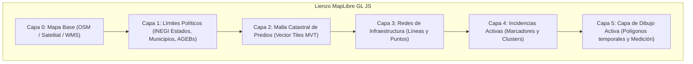

# TERRANOVA — Especificación de Arquitectura Geoespacial y Cartografía (GIS_SPECIFICATION.md)
**Código del Documento:** F1-05  
**Versión:** 1.0.0  
**Fecha:** 2026-11-05  
**Motores:** MapLibre GL JS (Frontend) + PostGIS 3.4 (Backend)  

---

## 1. Visión y Principios del Motor GIS
TERRANOVA implementa un motor cartográfico de alto rendimiento, abierto e independiente de proveedores propietarios. Su arquitectura garantiza:
- **Visualización Rápida:** Renderizado por GPU mediante WebGL a través de **MapLibre GL JS**.
- **Independencia de Proveedor de Mapa Base:** Capacidad de alternar entre OpenStreetMap (OSM), Carto, MapTiler, servidores locales de teselas raster/vectoriales o servicios satelitales institucionales.
- **Interoperabilidad OGC:** Consumo de servicios WMS (Web Map Service), WMTS (Web Map Tile Service) y WFS (Web Feature Service).
- **Compatibilidad INEGI:** Carga nativa de capas del Marco Geoestadístico Nacional (MGN) y coberturas territoriales del CENAPRED (Atlas Nacional de Riesgos).

---

## 2. Sistemas de Coordenadas y Referencia Espacial en México

```
+-----------------------------------------------------------------------------------------+
| [ENTRADA / INTERCAMBIO]                                                                 |
| WGS 84 (EPSG:4326) - Coordenadas Angulares (Longitud, Latitud)                          |
| Formatos: GeoJSON, Vector Tiles (MVT EPSG:3857), Shapefiles, KML                        |
+-----------------------------------------------------------------------------------------+
                                      │
                                      ▼ [TRANSFORMACIÓN DINÁMICA POSTGIS: ST_Transform]
+-----------------------------------------------------------------------------------------+
| [CÁLCULOS MÉTRICOS OFICIALES EN MÉXICO]                                                 |
| - Cobertura Nacional / Estatal: ITRF2008 / Mexico ITRF2008 (EPSG:6362)                  |
| - Precisión Submétrica Local (Catastro / Obras): Zonas UTM (WGS 84 / UTM North)        |
|     * Zona 11N (EPSG:32611): Baja California, Baja California Sur                       |
|     * Zona 12N (EPSG:32612): Sonora, Sinaloa, Chihuahua                                 |
|     * Zona 13N (EPSG:32613): Coahuila, Durango, Zacatecas                               |
|     * Zona 14N (EPSG:32614): Nuevo León, Tamaulipas, CDMX, Puebla, San Luis Potosí      |
|     * Zona 15N (EPSG:32615): Veracruz, Oaxaca, Chiapas, Tabasco                         |
|     * Zona 16N (EPSG:32616): Campeche, Yucatán, Quintana Roo                            |
+-----------------------------------------------------------------------------------------+
```

### Regla Técnica de Precisión Métrica:
Queda terminantemente prohibido calcular áreas o distancias directamente sobre coordenadas angulares (`EPSG:4326`) mediante fórmulas de plano euclidiano simple. Todo cálculo debe ejecutar la función espacial PostGIS sobre el CRS proyectado correspondiente:
```sql
-- Ejemplo: Cálculo de superficie real en m² de un predio en Puebla (Zona 14N)
SELECT ST_Area(ST_Transform(geom, 32614)) AS area_m2 FROM properties WHERE id = :propertyId;
```

---

## 3. Arquitectura de Capas Cartográficas



### 3.1 Estilos y Definición de Capas en JSON
Cada organización puede definir capas personalizadas cuya simbología se almacena en `map_layers.style_definition` compatible con la especificación MapLibre Style Spec:
```json
{
  "fill-color": "#17A987",
  "fill-opacity": 0.4,
  "stroke-color": "#0B1D2A",
  "stroke-width": 2
}
```

---

## 4. Generación de Vector Tiles Dinámicas (MVT)
Para visualizar cientos de miles de predios o manzanas sin saturar la memoria del navegador:
1. El backend expone un endpoint de teselas:
   ```
   GET /api/v1/gis/tiles/{layer_name}/{z}/{x}/{y}.pbf
   ```
2. La consulta PostGIS utiliza `ST_AsMVT` y `ST_TileEnvelope`:
   ```sql
   WITH tile_bounds AS (
       SELECT ST_TileEnvelope($1, $2, $3) AS geom_tile
   ),
   mvt_features AS (
       SELECT 
           p.id, p.cadastral_key, p.land_use,
           ST_AsMVTGeom(ST_Transform(p.geom, 3857), tb.geom_tile) AS geom
       FROM properties p, tile_bounds tb
       WHERE p.organization_id = $4 
         AND ST_Intersects(ST_Transform(p.geom, 3857), tb.geom_tile)
   )
   SELECT ST_AsMVT(mvt_features.*, $5) FROM mvt_features;
   ```
3. Las teselas generadas se almacenan en caché en **Redis** con un TTL configurable para garantizar tiempos de respuesta menores a 50 ms.

---

## 5. Descarga de Cartografía para Operación Offline
1. Los supervisores de campo pueden seleccionar un área de trabajo (Bounding Box - BBOX o polígono de colonia).
2. El sistema empaqueta las geometrías de predios, infraestructura e incidencias en un archivo **GeoJSON comprimido** o base local SQLite / Dexie.
3. Las teselas del mapa base para los niveles de zoom 12 a 17 se descargan en el caché de la PWA (`CacheStorage`), permitiendo navegación sin conexión a internet.
