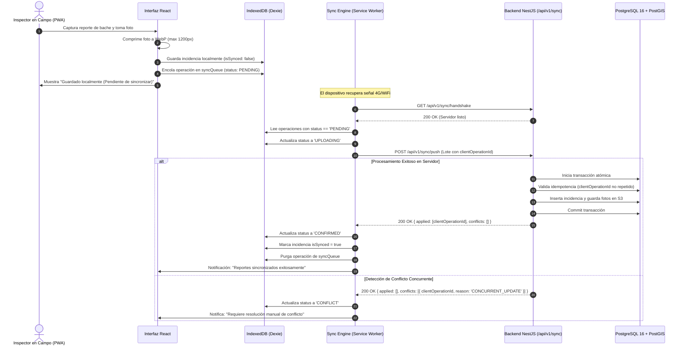

# TERRANOVA — Especificación de Operación Offline y Protocolo de Sincronización (OFFLINE_SYNC_SPEC.md)
**Código del Documento:** F1-06  
**Versión:** 1.0.0  
**Fecha:** 2026-11-05  
**Motor Offline:** PWA + Service Worker + Dexie.js (IndexedDB)  

---

## 1. Filosofía Offline-First
En TERRANOVA, la capacidad fuera de línea no es una adaptación secundaria, sino un **requisito de diseño fundamental de primer orden**. Las cuadrillas de servicios urbanos, supervisores de obra civil e inspectores de catastro operan frecuentemente en zonas con mala o nula cobertura celular (barrancas, zonas periurbanas, predios rurales, sótanos o zonas de desastre).

---

## 2. Categorización de Datos Locales

| Categoría | Descripción | Almacenamiento Local | Política de Actualización |
|---|---|---|---|
| **Datos Maestros** | Catálogos (tipos de falla, departamentos, estados, colonias) | IndexedDB (Dexie) | Descarga en login o sincronización bajo demanda (TTL 24h) |
| **Datos Operativos** | Incidencias locales, predios asignados, inspecciones | IndexedDB (Dexie) | Bidireccional con colas de mutación |
| **Archivos / Evidencias**| Fotografías tomadas con la cámara, firmas digitales | IndexedDB Blobs / Origin Private FS | Comprimidos en WebP localmente; enviados en segundo plano |
| **Datos de Sincronización**| Cola de operaciones pendientes (`sync_queue`), versiones | IndexedDB (Dexie) | Transaccional, inmutable hasta confirmación del servidor |

---

## 3. Esquema de Base de Datos Local en Cliente (Dexie.js)

```typescript
// apps/web/src/services/offline/terranova-offline.db.ts
import Dexie, { Table } from 'dexie';

export interface LocalSyncOperation {
  id?: number;
  clientOperationId: string; // UUID v4 único generado en dispositivo
  organizationId: string;
  userId: string;
  entityType: 'incidents' | 'inspections' | 'properties' | 'assets';
  operationType: 'INSERT' | 'UPDATE' | 'DELETE';
  payload: any;
  clientTimestamp: string;   // ISO UTC
  status: 'PENDING' | 'UPLOADING' | 'CONFIRMED' | 'CONFLICT' | 'FAILED';
  retryCount: number;
  lastError?: string;
}

export interface LocalIncident {
  id: string; // UUID local o remoto
  folio?: string;
  title: string;
  description: string;
  incidentType: string;
  priority: string;
  status: string;
  coordinates: [number, number]; // [lng, lat]
  localPhotos: string[];         // Blobs o Base64 temporales
  isSynced: boolean;
  createdAt: string;
}

export class TerranovaOfflineDB extends Dexie {
  syncQueue!: Table<LocalSyncOperation, number>;
  localIncidents!: Table<LocalIncident, string>;
  cachedCatalogs!: Table<{ key: string; data: any; updatedAt: string }, string>;

  constructor() {
    super('TerranovaOfflineDB');
    this.version(1).stores({
      syncQueue: '++id, clientOperationId, entityType, status, clientTimestamp',
      localIncidents: 'id, folio, status, isSynced',
      cachedCatalogs: 'key, updatedAt'
    });
  }
}
export const offlineDB = new TerranovaOfflineDB();
```

---

## 4. Diagrama del Ciclo de Vida de Sincronización



---

## 5. Resolución de los 7 Escenarios Obligatorios de Operación

| # | Escenario Operativo | Comportamiento Técnico del Sistema |
|---|---|---|
| **1** | **Se pierde la conexión a internet** | El Service Worker intercepta las peticiones de assets de UI (modo caché). La UI detecta el evento `window.addEventListener('offline')` y conmuta el indicador de estado a **"MODO SIN CONEXIÓN"** en color ámbar sin interrumpir la interacción del usuario. |
| **2** | **Se registra una incidencia sin red** | Los datos del formulario se validan localmente y se insertan en `localIncidents` y `syncQueue` con estado `PENDING`. El usuario recibe confirmación inmediata con identificador local provisional. |
| **3** | **Se toma una fotografía en campo** | La PWA accede a la cámara (`getUserMedia` o `<input capture>`), comprime la imagen a formato WebP manteniendo los metadatos EXIF de coordenadas GPS, y almacena el Blob en IndexedDB. |
| **4** | **Regresa la conexión a internet** | El navegador dispara el evento `online` o el Service Worker activa el `SyncManager`. El Sync Engine valida la latencia mediante un *handshake ping*, lee las operaciones pendientes y despacha el lote ordenado cronológicamente. |
| **5** | **Se modifica el mismo registro concurrentemente** | En datos operativos de cuadrillas (ej. bache), aplica estrategia *Last-Write-Wins* si los campos modificados no se traslapan. En datos críticos (catastro, expedientes legales), el servidor rechaza la sobrescritura y genera una bandera de conflicto (`requires_manual_merge`) en la bandeja del supervisor. |
| **6** | **Falla una transferencia durante la sincronización** | Si la red se interrumpe a mitad de una subida, la petición aborta. El Sync Engine incrementa `retryCount`, aplica retroceso exponencial (Exponential Backoff: 2s, 4s, 8s, 16s...) y regresa el estado a `PENDING`. Ningún registro se descarta. |
| **7** | **Se cierra la aplicación o se apaga el teléfono** | IndexedDB es un almacenamiento persistente no volátil en el disco del dispositivo móvil. Al reabrir TERRANOVA, la cola `syncQueue` permanece intacta y lista para sincronizar. |
