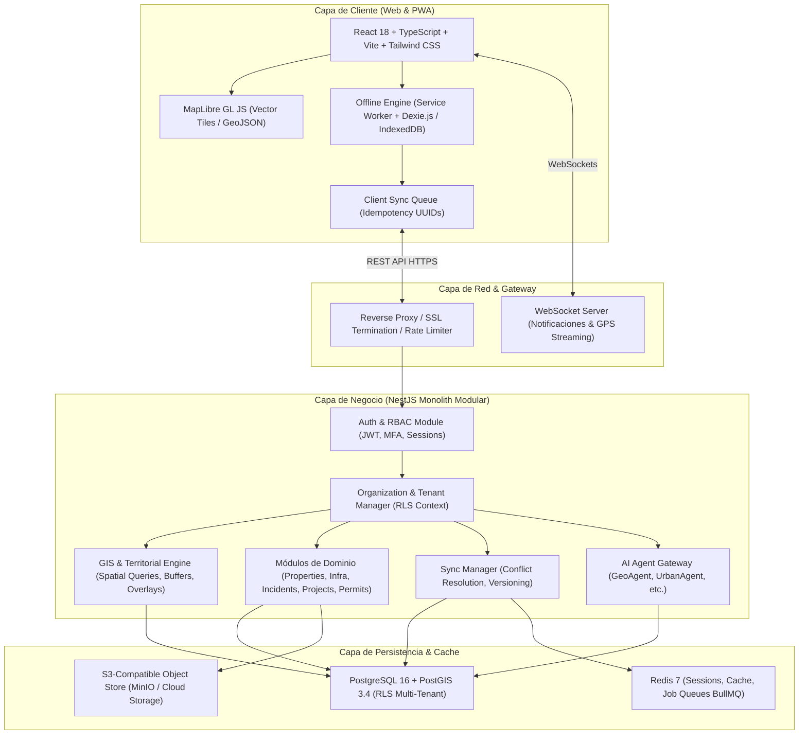

# TERRANOVA: Sistema Operativo de Inteligencia Territorial y Gestión Urbana
## Documento Maestro de Arquitectura Técnica (v1.0)
**Contexto Operativo:** República Mexicana (Federal, Estatal, Municipal, Localidades, Colonias/AGEBs y Predios)

---

### 1. Visión y Definición de Alto Nivel
TERRANOVA es una plataforma empresarial B2B/B2G de grado industrial concebida como un **Sistema Operativo de Inteligencia Territorial (Territorial OS)**. Permite a gobiernos municipales/estatales, desarrolladoras inmobiliarias, empresas de infraestructura y administradores urbanos centralizar, analizar, gobernar y proyectar la dinámica física, jurídica y operativa del territorio mexicano.

#### Dimensiones Clave:
1. **Multi-Tenancy Estricto (SaaS B2G/B2B):** Aislamiento lógico y criptográfico total de datos entre municipios u organizaciones mediante `organization_id` y PostgreSQL Row Level Security (RLS).
2. **Estándar Geográfico Nacional (INEGI MGN):** Integración nativa del Marco Geoestadístico Nacional (Estados `cve_ent`, Municipios `cve_mun`, Localidades `cve_loc`, AGEBs `cve_ageb`, Manzanas `cve_man`), compatible con el Catastro Municipal estándar y clave catastral unificada.
3. **Resiliencia Operativa Offline-First:** Arquitectura PWA con base de datos local (IndexedDB + Dexie.js) y sincronización transaccional con control de idempotencia para brigadas en campo sin cobertura de red.
4. **Capas Duales 2D / 3D (GIS & Digital Twin):** Renderizado de alta frecuencia con MapLibre GL JS (vector tiles / geoespacial rápido) y ruta de migración a CesiumJS/3D Tiles para gemelos digitales urbanos.
5. **Capa Agéntica Territorial (TERRANOVA AI):** Asistentes autónomos especializados con restricciones de ejecución estrictas (Zero Arbitrary SQL, consultas validadas por esquema).

---

### 2. Estructura Territorial de la República Mexicana
Para garantizar la validez legal, estadística y operativa en México, el motor de TERRANOVA modela la jerarquía territorial de acuerdo con el **INEGI (Instituto Nacional de Estadística y Geografía)** y las legislaciones de Catastro y Desarrollo Urbano:

```
[REPÚBLICA MEXICANA] (32 Entidades Federativas - Clave INEGI: 01 a 32)
   │
   └── [MUNICIPIO / ALCALDÍA] (2,477+ Municipios - Clave INEGI: 3 dígitos)
         │
         ├── [LOCALIDAD] (Urbana / Rural - Clave INEGI: 4 dígitos)
         │     │
         │     └── [SECTOR / COLONIA / BARRIO / CÓDIGO POSTAL]
         │           │
         │           └── [AGEB] (Área Geoestadística Básica: 4 caracteres alfanuméricos)
         │                 │
         │                 └── [MANZANA] (3 dígitos)
         │                       │
         │                       └── [PREDIO / LOTE CATASTRAL]
         │                             ├── Clave Catastral Estándar (Zona-Manzana-Lote-Edificio-Depto)
         │                             ├── Polígono Georreferenciado (PostGIS EPSG:4326 / EPSG:6362)
         │                             ├── Cédula Catastral / Ficha de Predio
         │                             ├── Uso de Suelo (H, C, I, E, etc.)
         │                             └── Infraestructura y Servicios vinculados
```

#### Sistemas de Referencia Espacial (CRS/SRID):
- **Almacenamiento e Intercambio Global:** `EPSG:4326` (WGS 84, Latitud/Longitud).
- **Proyecciones Métricas Oficiales de México (INEGI):**
  - `EPSG:6362` (ITRF2008 / Mexico ITRF2008 - Cónica Conforme de Lambert).
  - Zonas UTM específicas: `EPSG:32611` (Zona 11N) a `EPSG:32616` (Zona 16N) para cálculos submétricos de precisión en catastro y obra pública.

---

### 3. Diagrama Arquitectónico Modular



---

### 4. Estrategia Multi-Tenant y Seguridad Row-Level (RLS)
Cada consulta ejecutada por la API REST establece la variable de sesión de transacción en PostgreSQL:
```sql
SET LOCAL app.current_organization_id = 'org_uuid_del_inquilino';
```
Todas las tablas del sistema implementan políticas RLS que imposibilitan la filtración de datos entre organizaciones:
```sql
ALTER TABLE properties ENABLE ROW LEVEL SECURITY;
CREATE POLICY tenant_isolation_policy ON properties
    USING (organization_id = current_setting('app.current_organization_id')::uuid);
```
Adicionalmente, el Superadministrador de TERRANOVA dispone de modo auditor para soporte técnico con registro criptográfico en `audit_logs`.

---

### 5. Motor de Sincronización y Operación Offline-First
Para garantizar la operación de brigadistas e inspectores en colonias periurbanas, predios rurales o zonas de desastre sin cobertura 4G/5G:
1. **Almacenamiento Local (Dexie.js):**
   - Catálogos territoriales de la organización (colonias, tipos de fallas, formatos de inspección).
   - Teselas vectoriales / GeoJSON del sector de trabajo precargadas.
2. **Cola de Mutaciones Locales (`sync_operations`):**
   - Cada operación genera un `operation_id` (UUID v4) local con timestamp ISO UTC y vector de versión del cliente.
   - Las fotografías capturadas se almacenan como blobs comprimidos localmente (WebP 1200px max, metadatos EXIF georreferenciados preservados).
3. **Protocolo de Enlace al Detectar Conectividad:**
   - La PWA detecta `navigator.onLine` y verifica handshake contra `/api/sync/handshake`.
   - Envío por lotes de transacciones pendientes con clave de idempotencia.
   - El servidor procesa mediante transacción atómica: si una entidad fue modificada concurrentemente, aplica estrategia *Last-Write-Wins* parametrizable o deriva a bandera de revisión administrativa (`requires_manual_merge`).
   - La PWA purga los datos locales solo tras recibir acuse de recibo HTTP 200 con checksum verificado.
