# TERRANOVA: Plan de Desarrollo por Fases y Criterios de Aceptación
## Hoja de Ruta Gradual (16 Fases) & Matriz de Riesgos

---

### 1. Fases del Proyecto & Entregables Verificables

```mermaid
flowchart LR
    subgraph MVP ["BLOQUE 1: MVP Comercial (Fases 1 a 8)"]
        F1["Fase 01: Arquitectura & Monorepo"] --> F2["Fase 02: UX/UI Design System"]
        F2 --> F3["Fase 03: Backend & PostGIS"]
        F3 --> F4["Fase 04: Auth & Multi-tenant"]
        F4 --> F5["Fase 05: GIS Explorer Core"]
        F5 --> F6["Fase 06: Territorios & Predios"]
        F6 --> F7["Fase 07: Infraestructura"]
        F7 --> F8["Fase 08: Incidencias Urbanas"]
    end
    subgraph PRO ["BLOQUE 2: Versión PRO (Fases 9 a 13)"]
        F8 --> F9["Fase 09: Portal Ciudadano"]
        F9 --> F10["Fase 10: Proyectos y Obras"]
        F10 --> F11["Fase 11: Permisos y Trámites"]
        F11 --> F12["Fase 12: Field PWA Offline"]
        F12 --> F13["Fase 13: Analytics & BI"]
    end
    subgraph ADVANCED ["BLOQUE 3: Versión ADVANCED (Fases 14 a 16)"]
        F13 --> F14["Fase 14: AI GeoAgentes"]
        F14 --> F15["Fase 15: Digital Twin 3D"]
        F15 --> F16["Fase 16: Hardening & SaaS Launch"]
    end
```

---

### 2. Matriz de Criterios de Aceptación por Fase

| Fase | Nombre | Entregables Clave | Criterio de Aceptación Innegociable |
|---|---|---|---|
| **01** | **Arquitectura y Monorepo** | Estructura de carpetas, workspace `pnpm`, Docker compose, docs | Workspace compila, dependencias base listas, esquema documentado. |
| **02** | **UX/UI & Design System** | Layout maestro, paleta empresarial, modo claro/oscuro, componentes base | Responsive en móvil/escritorio, cero elementos sin interacción, tokens aplicados. |
| **03** | **Backend & DB PostGIS** | NestJS modular, TypeORM/Kysely con PostGIS, RLS configurado | Migraciones corren limpias, validación espacial ST_IsValid funcional. |
| **04** | **Auth, Roles y Multi-tenant**| JWT, MFA, RBAC, aislamiento estricto por organización | Ninguna consulta puede leer registros de otra organización (RLS verificado con pruebas). |
| **05** | **GIS Explorer** | Visor MapLibre GL JS, capas INEGI, polígonos, herramientas de medición | Cálculo de distancias y superficies en tiempo real con reproyección métrica. |
| **06** | **Territorios y Predios** | CRUD de predios, clave catastral mexicana, ficha técnica con polígono | Carga de geometrías sin colisiones espaciales inválidas, expedientes ligados. |
| **07** | **Infraestructura Urbana** | Inventario georreferenciado de luminarias, semáforos, redes hidráulicas | Filtro espacial por polígono/colonia y registro de historial operativo. |
| **08** | **Incidencias Urbanas** | Mesa de control con ciclo de vida completo de reportes | Folios automáticos secuenciales por municipio, evidencias fotográficas geoetiquetadas. |
| **09** | **Portal Ciudadano** | Portal público web/móvil con consulta de folios | Cero exposición de datos personales privados, rate-limiting y captcha funcional. |
| **10** | **Proyectos y Obras** | Control físico-financiero de contratos y obras públicas | Curva S de avance, porcentaje físico vs financiero calculado automáticamente. |
| **11** | **Permisos y Expedientes**| Flujo documental de trámites de uso de suelo y construcción | Trazabilidad de firmas, versionado de planos y resolutivos sin pérdida documental. |
| **12** | **Field PWA (Offline)** | Aplicación PWA con Dexie.js para cuadrillas | Permite registrar 50 incidencias/fotos sin internet y sincronizar al 100% sin duplicados. |
| **13** | **Analytics & BI** | Tableros de control, mapas de calor espacial y exportación ejecutiva | Tiempos de respuesta < 1.5s en agregaciones espaciales sobre 100,000 registros. |
| **14** | **TERRANOVA AI** | Agentes de consulta en lenguaje natural (GeoAgent, UrbanAgent) | Consultas con validación estricta de esquema (Zero SQL injection, respuestas trazables). |
| **15** | **Digital Twin 3D** | Visualización tridimensional urbana (CesiumJS / 3D Tiles) | Renderizado fluido a > 30 FPS en mallas urbanas con elevación de terreno. |
| **16** | **Hardening & Lanzamiento**| Pruebas de penetración, respaldos automatizados, onboarding SaaS | Auditoría de seguridad OWASP Top 10 superada, contratos de servicio (SLA) listos. |

---

### 3. Matriz de Riesgos Técnicos y Estrategias de Mitigación

1. **Riesgo 1: Filtración de Datos entre Gobiernos o Empresas (Cross-Tenant Leakage)**
   - *Severidad:* Crítica.
   - *Mitigación:* Se implementa **PostgreSQL Row Level Security (RLS)** a nivel de base de datos como política forzosa con tests automatizados continuos de inyección de tenant cruzado.
2. **Riesgo 2: Inconsistencias en Geometrías de Predios o Límites Municipales**
   - *Severidad:* Alta.
   - *Mitigación:* Validación geométrica previa en frontend y backend mediante `ST_IsValid`, `ST_MakeValid` y `ST_SimplifyPreserveTopology`. Ninguna geometría inválida puede persistirse.
3. **Riesgo 3: Conflictos de Sincronización en Cuadrillas Offline**
   - *Severidad:* Alta.
   - *Mitigación:* Claves de idempotencia universales (`client_operation_uuid`), versionado por entidad y cola transaccional que mantiene los registros locales intactos hasta la confirmación HTTP 200 del servidor.
4. **Riesgo 4: Sobrecarga en Servidores por Consultas Espaciales Masivas**
   - *Severidad:* Media-Alta.
   - *Mitigación:* Índices espaciales `GIST`, generación previa de Teselas Vectoriales (MVT / Mapbox Vector Tiles) para capas masivas como predios o manzanas del INEGI, y caché distribuida en Redis.
